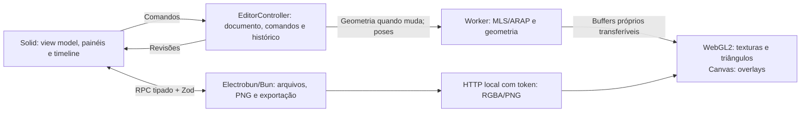

# Migração desktop: Electrobun, SolidJS e TypeScript

A migração autorizada em 12/10/2026 torna Electrobun + SolidJS a interface principal do chocoBones. A organização segue **Preparar → Rig → Animar**, com assets/estrutura à esquerda, palco ao centro, propriedades contextuais à direita e timeline por trilhas abaixo. O adaptador Slint permanece disponível, sem assumir paridade de todas as suas ferramentas com a nova GUI.

## Executar

Versões fixadas: Electrobun **2.0.2**, SolidJS **1.9.17**, Vite **8.3.4** e pnpm **12.9.1**. Instale Node.js 20.19+ ou 22.12+ e pnpm. A configuração escolhe explicitamente **Bun** como processo principal e **CEF** nas três plataformas, com GPU habilitada. Isso evita depender do default Cottontail da release ou de engines de webview diferentes por sistema.

```sh
pnpm install
pnpm run desktop:prepare
pnpm run typecheck
pnpm test
pnpm start
```

| Comando | Resultado |
|---|---|
| `pnpm run desktop:prepare` | Gera os módulos do SDK necessários aos tipos e à view |
| `pnpm start` | Prepara o SDK, gera a view e abre o desktop |
| `pnpm dev` | Mesmo pipeline, com watch do aplicativo |
| `pnpm dev:web` | Vite/browser, seleção de arquivos e downloads sem RPC nativo |
| `pnpm run build` | Compila TypeScript e gera `web-dist/`; não empacota o desktop |
| `pnpm run build:desktop` | Prepara SDK e view e executa build stable do desktop |
| `pnpm run legacy:start` | Abre a GUI Slint anterior |
| `pnpm run qa:editor` | QA automatizado da view Solid no browser |

O primeiro preparo baixa runtime, toolchain e artefatos CEF do Electrobun/Hutch. `.hutch/`, builds e caches são gerados, não versionados. O download precisa alcançar as origens oficiais do SDK; o bundle CEF tem custo de download e instalação maior que uma webview do sistema.

A release oferece macOS ARM64, Windows x64 e Linux x64/ARM64. O alvo oficial Linux é Ubuntu 24.04+; bibliotecas nativas GTK/WebKitGTK/AppIndicator/librsvg e as dependências do Chromium devem estar disponíveis conforme a documentação do SDK. Configurar as três plataformas não prova que seus builds foram executados. Assinatura, instaladores de distribuição e aceitação em GPU física exigem validação própria.

O script `scripts/run_desktop.mjs` prepara o SDK, gera a view e só então abre ou empacota o desktop. O bundle abre mesmo sem servidor Vite ativo. Se existir servidor Vite local, o canal dev pode carregar sua URL. `CHOCOBONES_DEV_URL` aceita somente HTTP em localhost/127.0.0.1. DevTools e debugging remoto são opt-in por `CHOCOBONES_DEVTOOLS=1` e `CHOCOBONES_DEBUG_PORT`; não fazem parte do comportamento padrão do aplicativo.

No canal stable a view vem de `views://editor/index.html`. O hook de inspeção do roteiro de QA aparece no Vite em desenvolvimento ou quando o host é iniciado explicitamente com `CHOCOBONES_QA=1`; não está exposto no lançamento normal do bundle.

## Ambiente cloud com proxy

Neste ambiente Linux x64, o bootstrap Hutch encontrou uma resposta Cloudflare 1010 e o fetch nativo da toolchain Zig não acompanhou o proxy da sessão. O fallback [setup_cloud_desktop.py](../../scripts/setup_cloud_desktop.py) preenche o cache a partir de manifests HTTPS oficiais, verifica tamanho/SHA-256, extrai com validação de caminhos e executa o próprio preparo/validação do SDK. Não desativa TLS ou checksums. Ele é específico das versões e do Linux x64, não um instalador universal.

```sh
python3 scripts/setup_cloud_desktop.py --workspace "$PWD" --tools /workspace/.tools
```

Em máquinas onde o bootstrap normal funciona, use `pnpm start`. O fallback não instala bibliotecas gráficas do sistema. A execução cloud usa Xvfb e bibliotecas nativas locais; o CEF desse ambiente bloqueou WebGL2 por software e o palco utilizou Canvas2D. Isso valida o fallback, sem provar o caminho GPU em hardware físico.

Os campos **install_script** e **start_skill** foram testados e salvos como rascunho na configuração do ambiente cloud. O script instala o pnpm fixado, valida downloads oficiais do SDK, extrai bibliotecas de pacotes Debian com índice assinado para um prefixo local, prepara o SDK e verifica tipos/build/testes. Ele gera `/workspace/.runtime/chocobones-desktop-env.sh` com proxy, caches, toolchain e bibliotecas, sem alterar arquivos do sistema. O rascunho ainda precisa ser revisado/salvo e publicado nas configurações do ambiente; salvá-lo não ativa automaticamente uma nova configuração.

No snapshot já preparado, com Xvfb disponível em `:120`, a execução usa:

```sh
source /workspace/.runtime/chocobones-desktop-env.sh
export DISPLAY=:120
pnpm start
```

O Xvfb foi executado com `-screen 0 1600x1000x24 -nolisten tcp -extension MIT-SHM`. O launcher nativo precisou executar fora do sandbox de user namespace da sessão, pois o Hutch recusava seu diretório temporário confiável nesse namespace; não foram relaxadas permissões de arquivos nem checksums. Esse detalhe é do ambiente cloud, não um requisito geral do produto.

## Fronteiras da aplicação



O **EditorController da view** possui a autoridade do documento. Comandos e histórico são portáveis para o browser; mapas, pose, geometria e caches ficam fora da árvore reativa do DOM. Solid apresenta o view model e revisões de edição. Um gesto de ponteiro corresponde a uma transação de histórico, com preview durante o arrasto.

O **host Bun** abre/decodifica PNGs, lê/escreve projetos, apresenta diálogos nativos e exporta imagens. RPC é tipado e validado em runtime por Zod; comandos, metadados e manifests viajam em JSON. Assets RGBA/PNG usam um servidor restrito a loopback com token de sessão e URLs binárias. Não há envio de framebuffer completo em JSON a cada frame. O host incorpora as imagens ao salvar, preservando portabilidade do projeto.

O **worker de deformação** conserva cópias da geometria de repouso. Mudanças na malha/pinos atualizam essa geometria; poses enviam offsets. A fila admite uma tarefa em execução e uma pendente substituível. Resultados de outro documento são descartados; a última pose concluída do mesmo documento pode aparecer enquanto a seguinte é calculada. Os buffers transferidos pertencem à saída do worker, sem destacar os arrays utilizados pelo documento e pelo undo.

O **palco WebGL2** mantém texturas e buffers residentes e desenha os triângulos deformados. Um Canvas separado desenha pinos, ossos, seleção e gizmos. Ambos vivem na mesma webview, permitindo menus HTML sobre o palco. Rasterização software é fallback. O pacote de deformação é compartilhado com o raster CPU usado para exportação, mas filtros e cobertura de pixels dos backends não são necessariamente idênticos.

## Fluxo real de arquivos

1. Importar PNG usa diálogo nativo e gera assets/camadas.
2. Abrir projeto valida formato, imagens e referências antes de substituir o documento.
3. Salvar incorpora PNGs e usa arquivo temporário antes da publicação no destino.
4. Salvar como oferece nome no modal do editor e pasta pelo seletor nativo.
5. Exportar PNG usa a pose atual e alfa, sem overlays; spritesheet permite escolher quadros e colunas.

Alterações pendentes abrem um modal Salvar/Descartar/Cancelar antes de novo/abrir projeto ou fechar a janela desktop. Cancelar a gravação ou editar durante o salvamento conserva a marca de alteração e impede o descarte automático. Novo/abrir limpa o histórico do documento anterior. Tema e dimensões dos painéis persistem separadamente do projeto.

A superfície TS do SDK 2.0.2 não oferece save dialog. O modal mais seletor de pasta é a implementação efetiva, com validação de nome e escolha de substituição. O adaptador browser usa `File` e downloads; ele valida o fluxo da GUI, mas não exercita o transporte Electrobun ou seus diálogos.

## Reuso e limites

A migração preserva formato de projeto, matemática, evaluator, MLS, ARAP real, refinamento conforme e histórico. Não reimplementa automaticamente todo o núcleo antigo no inspetor. A visualização 3D existente foi preservada. Editor gráfico de curvas, mistura de clipes, pintura de pesos, caminhos e integração completa dos módulos 3D/BBW/cage continuam pendentes; recursos desabilitados não devem ser descritos como ferramentas concluídas.

O worker evita bloquear o chrome; não faz o ARAP CPU resolver mais rápido. O benchmark anterior de 1.304 vértices mediu aproximadamente 112 ms por pose, excluindo UI/desenho/export. WebGL2 acelera rasterização. Tamanho final, memória, startup e P95 de interação do pacote CEF ainda precisam de medições próprias; a configuração não sustenta promessas de 60 FPS ou footprint mínimo.

## Evidências

A suíte atual passou **303 testes em 30 suítes**. As três checagens TypeScript (núcleo, view e host) e a geração da view Vite passaram. Regressões cobrem documento/histórico, pose de juntas/camadas/pinos, contratos nativos e fila limitada do worker; o núcleo matemático anterior permanece incluído.

Os [relatórios e capturas Solid](screenshots/solid-editor/README.md) registram **19 verificações no browser Chromium/WebGL2 com DPR 2** e **20 no aplicativo Electrobun/Bun/CEF Linux em desenvolvimento**, cuja view veio do Vite. O browser usou arquivos e downloads reais; o desktop verificou RPC, transporte de PNG/RGBA e gravação/reabertura/export pelo host Bun. O seletor de arquivos do sistema operacional não foi automatizado. A execução nativa cloud usou Canvas2D, e o browser usou WebGL2 com SwiftShader.

As 267 verificações unitárias e capturas Slint da entrega anterior permanecem como baseline histórico. Configurar CEF nas três plataformas não comprova execução de macOS/Windows ou aceitação em GPU física.

[Organização da interface](editor-ui.md) · [Avaliação e fontes da stack](electrobun-solid-evaluation.md) · [Estado atual](../../PROJECT_STATE.md).

### Validação do pacote Linux

O [pacote stable sem Vite](screenshots/solid-editor/packaged/report.json) passou **25 verificações de interface** e **4 de fechamento nativo**, com fontes/ícones, worker, transporte binário, salvamento, reabertura, exportação e preferências. A aplicação foi extraída com tar do sistema. O autoextrator Linux do SDK falhou com `TarUnsupportedFileType`; o instalador de distribuição permanece pendente. Windows/macOS e GPU física não foram executados.
