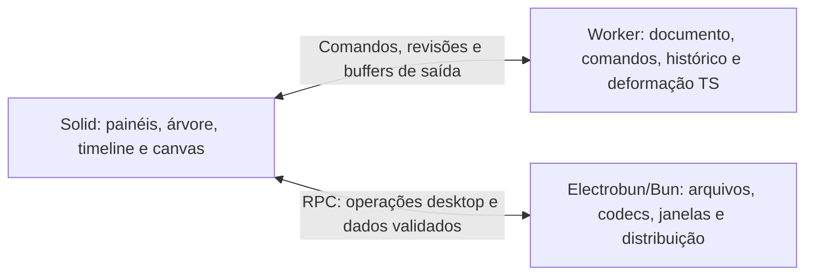

# Avaliação: Electrobun + SolidJS + TypeScript

## Decisão e implementação

Em 12/10/2026, o usuário autorizou a migração. Electrobun 2.0.2 + SolidJS 1.9.17 + TypeScript passa a ser a GUI principal, com Bun explicitamente escolhido, CEF nas três plataformas, palco WebGL2/Canvas e worker de deformação. A interface adota Preparar/Rig/Animar, inspetor contextual e timeline por trilhas. Slint permanece como implementação legada.

A decisão adotou as fronteiras propostas nesta avaliação: documento e comandos portáveis na view, IO/codecs no host, RPC tipado com Zod e imagens binárias via loopback com token. O editor é a autoridade do documento; o worker calcula deformação e mantém uma tarefa em execução e uma pendente. Salvar/exportar combina modal próprio e seletor nativo de pasta, pois o SDK não oferece save dialog TS.

O guia [Migração desktop](desktop-migration.md) descreve execução, arquitetura e limites implementados. Builds/aceitação em todas as plataformas, footprint CEF e desempenho em GPU física não devem ser considerados validados pela decisão.

A validação atual passou **303 testes em 30 suítes**, tipos do núcleo/view/host e build Vite. Os [relatórios Solid](screenshots/solid-editor/README.md) registram 19 verificações no browser Chromium/WebGL2/DPR 2 e 20 no host real Electrobun/Bun/CEF Linux em desenvolvimento. A view desse host foi servida por Vite; RPC, transporte binário e filesystem foram exercitados. O browser utilizou SwiftShader e o CEF cloud, Canvas2D. Esses resultados não substituem medições de footprint/startup nem aceitação em macOS/Windows e GPU física.

## Avaliação inicial

Consulta documental em 12/10/2026, anterior à implementação. As recomendações abaixo registram o estado observado naquele momento. Não havia aplicativo Electrobun instalado/executado ou medições dessa stack nesta avaliação inicial.

### Recomendação inicial

SolidJS + TypeScript é uma boa base para redesenhar os painéis, hierarquia, propriedades, menus e timeline. Electrobun é uma candidata viável para o shell desktop, condicionada à validação de renderização, diálogos, empacotamento e comportamento nas plataformas escolhidas.

A organização da interface precisa acompanhar os fluxos Preparar → Rig → Animar. A stack fornece mecanismos de UI e integração desktop; docking, edição de keyframes, exposição das ferramentas e manipulação do personagem continuam sendo funcionalidades do chocoBones.

## Adequação ao editor

| Necessidade | Contribuição da stack | Trabalho necessário |
| --- | --- | --- |
| Painéis contextuais e propriedades | Solid atualiza os controles pelas dependências reativas; HTML/CSS oferece liberdade de composição | Definir seleção, agrupamento, estados vazios, disponibilidade e progressão das ferramentas |
| Árvore de camadas/rig e timeline | Componentes reutilizáveis, listas e eventos do browser | Hierarquia, seleção múltipla, virtualização, trilhas, keyframes, curvas e acessibilidade |
| Temas e ícones | Tokens CSS e SVG funcionam no editor web | Reusar os SVGs Phosphor existentes em componentes Solid; manter contraste e navegação por teclado |
| Núcleo TypeScript | Matemática, FK/IK, evaluator, MLS e ARAP têm funções aproveitáveis | Extrair documento e serviços dos adaptadores Slint/Node; preservar contratos e testes |
| Desktop | Electrobun tem janelas, menus, clipboard, diálogo de abertura, packaging e updater | Validar diálogos de salvamento, assinatura, distribuição, atalhos e arquivos reais |
| Palco acelerado | Canvas/WebGL e, conforme engine/GPU, WebGPU na webview; Dawn nativo é outra opção | Implementar desenho de sprites/malhas, picking, gizmos, composição, DPR e exportação |
| Responsividade | Worker permite executar deformação fora da thread da interface | Controlar fila de jobs, revisões, cancelamento e latência; otimizar o solver separadamente |

## Estado verificado do Electrobun

A release estável consultada é [v2.0.2](https://github.com/blackboardsh/electrobun/releases/tag/v2.0.2), publicada em 29/09/2026, com licença MIT. Existe [template oficial Solid + Vite + TypeScript](https://github.com/blackboardsh/electrobun/tree/v2.0.2/templates/solid).

É necessário fixar a release e escolher o runtime explicitamente. Na v2.0.2 o default é Cottontail; o README de `main` já apresenta Bun como default e Cottontail como experimental. Para aproveitar filesystem, Buffer e zlib do código atual, a primeira avaliação deveria selecionar Bun. A compatibilidade efetiva dessas APIs precisa passar pelos testes do projeto. Hutch gerencia build/toolchains e pode delegar o package manager ao pnpm.

| Plataforma | Artefatos da v2.0.2 | Consideração |
| --- | --- | --- |
| macOS | ARM64 | Não há core Intel publicado nessa release; README cita macOS 14+ |
| Windows | x64 | Windows ARM usa emulação; ARM64 beta de `main` não consta dessa release; README cita Windows 11+ |
| Linux | x64 e ARM64 | Ubuntu 24.04+ como alvo oficial; GTK/WebKitGTK/AppIndicator/librsvg são dependências do sistema |

As webviews do sistema são WKWebView, WebView2 e WebKitGTK. Isso exige validar CSS, input e APIs gráficas por engine. CEF é opcional e permite incorporar Chromium pinado, aumentando download e instalação. No Linux não se misturam CEF e WebKit no mesmo processo; as dependências Linux descritas continuam relevantes. Não há medição local de tamanho, memória ou startup do chocoBones nessa stack.

O [SDK Utils da release](https://github.com/blackboardsh/electrobun/blob/v2.0.2/package/src/sdks/main/core/Utils.ts) inclui `openFileDialog`; não foi encontrada uma API de save dialog nessa superfície TS. Salvar/exportar exigirá um adaptador validado. A assinatura/notarização macOS é integrada; assinatura Windows não faz parte do pipeline Hutch da release consultada. Estes são critérios para o protótipo desktop.

## Renderização e comunicação

Recomendo começar com uma única webview: Solid controla a estrutura; um canvas apresenta o palco. Canvas 2D pode preservar inicialmente o raster CPU atual. WebGL2 oferece um caminho para texturas e triângulos residentes na GPU; WebGPU precisa de detecção e validação nas engines alvo.

O `bundleWGPU` do Electrobun disponibiliza Dawn nativo. Contudo, a superfície `<electrobun-wgpu>` fica acima do HTML: `z-index` não coloca menus por cima dela. Composição exige masks e input passthrough; há restrições em janelas transparentes no Linux. Esse caminho merece um protótipo próprio de menus, docking, gizmos, captura e input antes de integrar o editor.

O backend atual [webgpu_backend.ts](../../src/render/webgpu_backend.ts) compila módulos WGSL, mas `submitSprites` ainda não cria/submete o pipeline de desenho. Portanto, a migração não parte de um renderer GPU completo.

O RPC do Electrobun é tipado, porém os schemas são types-only e o transporte usa JSON. Reusar Zod para validação runtime e enviar comandos, metadados e snapshots/deltas serializáveis. Não transmitir framebuffer RGBA por frame, nem tratar `Map` e typed arrays como DTOs JSON automaticamente. A transferência inicial de imagens precisa de um caminho explicitamente validado.

Uma separação possível para o protótipo:

O documento precisa ter uma autoridade clara. O worker é uma opção, a confirmar no protótipo; o store Solid reflete as propriedades exibidas e o estado da interface. Salvamento/exportação operam sobre snapshots consistentes do mesmo documento e avaliador.

## Reuso e fronteiras do código atual

| Código | Situação |
| --- | --- |
| `core`, `rig`, `animation/evaluator`, `deform/arap_solver` | Núcleo matemático em TS aproveitável, sem vínculo direto com Slint |
| `mesh/adaptive_sprite_mesh`, `render/sprite_raster` | Arrays portáveis em princípio, mas importam validação do módulo PNG que também depende de Node; separar tipos/validação de codecs |
| [store.ts](../../src/ui/store.ts) | Mistura documento, UI, playback, classes, Maps, buffers e IO; importa `fs` e inicializa OBJ síncrono |
| [bridge.ts](../../src/ui/bridge.ts) | 716 linhas com janela `any`, callbacks e modelos Slint; preservar comportamento dos comandos e substituir o adaptador |
| [png.ts](../../src/assets/png.ts) e [png_export.ts](../../src/render/png_export.ts) | Buffer/zlib; manter inicialmente no host ou serviço compatível e verificar comportamento em Bun |
| [project.ts](../../src/project/project.ts) e [project_io.ts](../../src/ui/actions/project_io.ts) | Formato/Zod aproveitáveis; Buffer/filesystem/path precisam de fronteira desktop |
| [loop.ts](../../src/render/loop.ts) | Loop e apresentação ligados a Slint/ImageData; criar adaptador browser com scheduling e gerenciamento de recursos próprios |

Não envolver o `AppState` inteiro em `createStore`. As mutações atuais em `Map`, classes e typed arrays não ganham reatividade granular automaticamente. Usar stores para objetos/arrays exibidos, comandos tipados para edição e revisões para resultados pesados. Pose, pixels, geometria e caches permanecem fora da árvore reativa do DOM.

Histórico deve continuar transacional: um arraste corresponde a uma edição, com preview durante o gesto. O histórico atual compartilha pixels imutáveis; transferir diretamente o `ArrayBuffer` dessas imagens a um worker destacaria a memória usada pelo documento. Copiar uma vez para o worker e transferir buffers de saída próprios evita essa quebra.

## Performance e critérios de decisão

O [benchmark atual](screenshots/deformation-tools/solver-benchmark.json) mede cerca de 112 ms por pose com 1304 vértices, somente no ARAP CPU. Solid, Bun e worker não garantem redução desse custo. O worker evita bloquear a thread da interface; o solver continua tendo latência. Coalescer movimentos do ponteiro e descartar respostas antigas por revisão evita uma fila crescente de poses.

Antes de escolher a migração, o protótipo precisa atravessar um fluxo real: importar PNG/projeto, editar rig/pino, desfazer/refazer, reproduzir e navegar na timeline, salvar/reabrir e exportar. Verificar DPR 1/2, resize, foco/atalhos, menus sobre o palco e execução do bundle nas plataformas alvo. Medir latência de input, tempo de frame/P95, memória e tamanho do pacote.

Manter o mesmo documento, geometria, tempo e avaliador entre preview e export. Se o preview usar GPU e a exportação preservar o raster CPU, diferenças de filtragem/rasterização exigem tolerâncias e testes visuais definidos; não prometer identidade byte a byte entre backends.

A decisão recomendada é adotar SolidJS/TS como direção da UI e avaliar Electrobun num protótipo vertical antes de substituir o shell inteiro. O desenho Preparar/Rig/Animar, a exposição das funcionalidades e as ferramentas pendentes devem orientar esse protótipo.

## Fontes

- [Release e código v2.0.2](https://github.com/blackboardsh/electrobun/releases/tag/v2.0.2)
- [Template Solid oficial](https://github.com/blackboardsh/electrobun/tree/v2.0.2/templates/solid)
- [Plataformas na release](https://github.com/blackboardsh/electrobun/blob/v2.0.2/docs/src/content/docs/electrobun/guides/cross-platform-development.mdx)
- [Arquitetura Electrobun](https://framework.blackboard.sh/electrobun/guides/architecture/overview/)
- [CEF](https://framework.blackboard.sh/electrobun/apis/bundling-cef/)
- [RPC/Electroview](https://framework.blackboard.sh/electrobun/apis/browser/electroview-class/)
- [WebGPU nativo](https://framework.blackboard.sh/electrobun/apis/webgpu/) e [composição da superfície](https://framework.blackboard.sh/electrobun/apis/browser/electrobun-wgpu-tag/)
- [Assinatura](https://framework.blackboard.sh/electrobun/guides/code-signing/) e [atualizações](https://framework.blackboard.sh/electrobun/guides/updates/)
- [Solid signals](https://docs.solidjs.com/concepts/signals), [stores](https://docs.solidjs.com/concepts/stores) e [batch](https://docs.solidjs.com/reference/reactive-utilities/batch)
- [Implementação oficial dos stores Solid](https://github.com/solidjs/solid/blob/main/packages/solid/store/src/store.ts)

As páginas do site Electrobun acompanham `main`; capacidades da release foram conferidas também no tag v2.0.2. As propostas acima registram a avaliação inicial; os resultados efetivos da migração são documentados no guia desktop e no estado do projeto.
