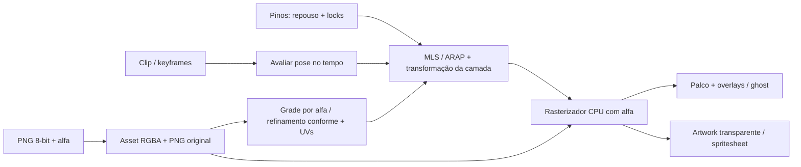

# Ferramentas de puppet: Warp Studio, Cartoon Animator e chocoBones

Esta análise orienta o fluxo **importar uma figura → preparar malha e controles → deformar → animar → revisar → exportar** no chocoBones. A referência Warp Studio encurta a preparação de imagens únicas com pinos. A referência Cartoon Animator transforma ações do mouse em performances parametrizadas e combina movimento principal, secundário e clips. A adaptação reúne esses princípios no documento e no renderizador próprios do chocoBones.

A consulta às fontes públicas ocorreu em **12 de outubro de 2026**. As capacidades dos concorrentes abaixo são documentadas ou observadas em suas mídias públicas; não constituem benchmark nem teste executado de suas aplicações comerciais. A seção de implementação descreve o código desta etapa, e a seção de aceitação define o resultado observável que a validação deve conferir.

## Fontes, evidência e limites

| Fonte | O que foi consultado | Limite da evidência |
| --- | --- | --- |
| [Warp Studio — página oficial itch.io](https://crockiestar.itch.io/warp-studio) | Descrição, requisitos, módulos, formatos, distribuição e GIFs públicos | Declarações do autor e demonstrações; implementação interna não disponível |
| [GIF do tamanduá](https://img.itch.zone/aW1nLzI4NzE0ODA2LmdpZg==/original/yVwjBI.gif) e [GIF do personagem árvore](https://img.itch.zone/aW1nLzI4NzE0NjY2LmdpZg==/original/Dnlb5S.gif) | Primeiro, meio e último frames das cenas anexadas pelo usuário | Permitem ler controles e observar movimento; não demonstram algoritmo ou garantias numéricas |
| [Cartoon Animator — página oficial](https://www.reallusion.com/cartoon-animator/) | Panorama dos fluxos de criação, rig, animação, captura e composição | Marketing funcional; não especifica a arquitetura interna |
| [Motion Pilot / Puppet Animation](https://www.reallusion.com/cartoon-animator/puppet-animation.html) | Transform, Wave, Motion, Flock e gravação | O texto e a imagem pública do painel foram examinados; vídeos não reproduzidos |
| [CTA 5.2 Puppet and Path Feature Reference](https://docs.google.com/presentation/d/1C5jTtj87m1XHQugCjd___XVaRMa8WpxhGRSlMhVQ1A0/edit?usp=sharing) | Texto dos slides do guia oficial linkado pela página Motion Pilot | Guia da versão 5.2; slides com animações não foram reproduzidos como vídeo |
| [Motion Path Animation](https://www.reallusion.com/cartoon-animator/motion-path-animation.html) | Bézier, progressão, orientação, offset e reutilização | Confirma o fluxo, sem publicar algoritmo de parametrização |
| [2D Character Animation Editing](https://www.reallusion.com/cartoon-animator/2D-character-animation.html) | Edição de clips, curves, IK/FK e movimento secundário | Não demonstra compatibilidade com dados chocoBones |
| [2D Character Creation](https://www.reallusion.com/cartoon-animator/2D-character-creation.html) | Rig customizado, pins, sprites, layers, máscaras e templates | A página inclui recursos de versões diferentes, inclusive 5.33 |
| [Spring Animation](https://www.reallusion.com/cartoon-animator/spring-animation.html) | Cadeias, grupos, parâmetros e reação ao movimento principal | Não documenta solver físico proprietário |
| [Inverse Kinematics](https://www.reallusion.com/cartoon-animator/inverse-kinematic.html) | Locks, IK/FK, bend direction, retarget e GUI do rig | Não fornece implementação de Smart IK |
| [Exaggeration / FFD](https://www.reallusion.com/cartoon-animator/exaggeration-animation.html) | Lattice, intensidade, keys, clips e efeitos aditivos | FFD não equivale automaticamente a MLS ou ARAP |
| [Puppet Stage / Trigger Animation](https://www.reallusion.com/cartoon-animator/trigger-animation.html) | Triggers, tracking, voice sync, cameras e live streaming | Módulo mais amplo que o fluxo inicial de pinos |
| [Sampling and Flattening Keys — manual 4.2](https://manual.reallusion.com/Cartoon-Animator/Content/Resources/4.2/09_Timeline/Sampling_and_Flattening.htm) | Sample por partes e consolidação de layer keys em clip | Fonte histórica oficialmente linkada; suas restrições não devem ser generalizadas para todas as versões |

Os links [DnelvCBHTe8](https://www.youtube.com/watch?v=DnelvCBHTe8), [FFGBY5AKxHo](https://www.youtube.com/watch?v=FFGBY5AKxHo) e [Eu7vO2uGGN4](https://www.youtube.com/watch?v=Eu7vO2uGGN4), incluindo consultas oEmbed, receberam **HTTP 403 do proxy** (`Tunnel connection failed: 403 Forbidden`). Não foram assistidos nem transcritos. A página Warp Studio incorpora DnelvCBHTe8; a página Motion Pilot aponta Eu7vO2uGGN4 como apresentação. Essas associações são verificáveis no HTML oficial, mas não autorizam atribuir conteúdo específico aos vídeos. FFGBY5AKxHo permanece sem conteúdo confirmado.

O guia Google Slides foi acessível no HTML público. Seu endpoint de exportação TXT respondeu 401; foi utilizado somente o texto já disponível publicamente. Não foram usadas credenciais ou acesso privado.

Há diferenças de versão na página Warp Studio: uma seção cita 1.2.1, o download cita 1.2.3 e um GIF antigo mostra login/créditos. A descrição atual informa compra única, aplicativo portátil e fluxo manual offline. Controles legados de pricing não são requisitos para o chocoBones.

### Como interpretar esta comparação

| Classe | Significado | Exemplo |
| --- | --- | --- |
| Capacidade documentada | A fonte oficial declara a funcionalidade | Motion Pilot possui Click to Play e Click to Loop |
| Observação visual | A mídia pública mostra um controle ou resultado | Warp tem Mesh Rows / Cols e checkbox de refinamento da silhueta |
| Inferência | Interpretação plausível, sem garantia publicada | Poucos controles podem reduzir o esforço inicial de preparação |
| Proposta | Decisão de projeto para uma implementação própria | Perfis chocoBones com eixos, suavização temporal e mistura por máscara |

Um rótulo “ARAP”, um GIF ou o nome “Smart IK” não revela bibliotecas, equações, graphics API, precisão ou custo computacional. O comportamento desejado precisa ser definido e validado no chocoBones independentemente desses nomes.

## Dois fluxos complementares

Warp Animate 2D começa por uma **superfície de imagem deformável**. O usuário importa artwork, cria uma malha, insere controles e muda poses. A descrição oficial inclui links de ossos, ferramentas de malha, presets e timeline, mas um esqueleto detalhado não é condição para a primeira animação. Nos GIFs do usuário, uma figura inteira responde a poucos controles; não há evidência de dezenas de partes previamente recortadas.

Motion Pilot começa por um **alvo animável e um perfil de performance**. O mouse fornece deslocamento, direção, velocidade e clique. Transform, Wave e Motion interpretam esses sinais; Flock distribui o efeito entre alvos. A gravação acontece durante a performance e pode combinar movimento existente com novas passadas.

No chocoBones, o primeiro fluxo deve funcionar para uma figura PNG sem rig obrigatório. O rig existente continua útil quando o usuário precisa de articulações, hierarquia, IK e peças separadas. A evolução para performance parametrizada deve reutilizar a mesma avaliação de pose, persistência e exportação, em vez de produzir um segundo sistema desconectado.

## Comparação da preparação e deformação

| Sistema | Warp Studio: documentado/observado | Cartoon Animator: documentado | chocoBones nesta etapa |
| --- | --- | --- | --- |
| Imagem inicial | PNG/JPEG/WebP; figura única ou múltiplas imagens | Bitmap, SVG e PSD com pipelines específicos | PNG não entrelaçado, 8 bits por canal; textura RGBA no documento |
| Preparação de malha | Densidade, padding, força, qualidade de borda e refinamento local da silhueta | Pins associados a ossos e ajustes de subdivisão para dobra | Grade por alfa; refinamento conforme de células mistas, borda 2–32 px e orçamento de vértices; UVs persistidas |
| Controles diretos | Pins, poses, locks e links de ossos | Bone Editor, pins, FK/IK e effector locks | Criar/selecionar/arrastar/remover pinos, âncoras locais e sugestão geométrica |
| Deformação | Descrição anuncia Smart ARAP, natural displacement e bone-based | Skin/rig e FFD por lattice, com intensidade e keys | MLS ou ARAP local/global 2D selecionáveis; textura e wireframe compartilham a malha deformada |
| Silhueta e vazios | GIF declara refinar células que cruzam a borda | Mask Editor para separar partes de personagens complexos | Transparência preservada na textura; ocupação da grade não recorta um contorno geométrico exato |
| Peças e sprites | Multi-image, frame swaps e módulo Puppet por partes | Sprite variants, layer order, gestures e sequences | Camadas PNG independentes; edição de variantes/máscaras permanece futura |

### O que a malha baseada em alfa garante agora

[buildSpriteMesh](../../src/mesh/sprite_mesh.ts) examina os pixels de cada célula. Uma célula é mantida quando contém alfa acima do limiar, e seus dois triângulos recebem UVs da imagem de origem. Isso evita depender apenas de cinco amostras esparsas, que poderiam perder uma linha ou uma pequena região opaca.

[buildAdaptiveSpriteMesh](../../src/mesh/adaptive_sprite_mesh.ts) oferece um segundo caminho: uma imagem integral conta todos os pixels opacos, e só células que misturam conteúdo e transparência são subdivididas. Vértices de vizinhos mais finos entram nas arestas das células grossas antes da triangulação; a topologia é conforme, sem T-junctions. O interior pode permanecer grosso enquanto a borda ganha detalhe. UVs continuam amostrando o alfa original.

**Limiar de alfa** decide quais pixels contam como conteúdo. **Tamanho da célula de borda**, de 2 a 32 pixels, orienta o detalhe geométrico; não é uma tolerância de erro do contorno. Ative **Refinar contorno**, ajuste o valor e pressione **Aplicar**. O orçamento pode interromper o refinamento antes do tamanho pedido, e o painel informa essa condição. O editor limita a malha refinada a 3968 vértices, reservando até 128 posições adicionais para controles antes do teto ARAP de 4096.

A malha aproxima a silhueta por células. Não há triangulação constrained Delaunay ou recorte geométrico exato de furos. Regiões transparentes continuam invisíveis pela textura, mas regiões próximas podem compartilhar uma célula ou vértices. Transparência visual não comprova separação topológica de ilhas; furos menores que a célula podem permanecer cobertos geometricamente, com alfa zero na textura.

### Controles por pinos e coordenadas

[pin_space.ts](../../src/ui/viewport/pin_space.ts) compartilha as transformações usadas por desenho, picking e arrasto. O pino é definido em coordenadas locais da imagem; camada e FK o levam ao mundo, e pan/zoom o levam ao viewport. A inversa devolve o ponteiro ao espaço local antes de editar repouso ou offset. Matrizes singulares, camadas bloqueadas/ocultas e pinos desabilitados não são alvos de edição.

Em **Montagem/Setup**, mover um pino altera sua posição de repouso. Em **Animação**, mover um pino altera um delta de pose, que pode ser gravado em keyframe. O lock de pino segura esse controle no espaço local da imagem. Ele **não equivale a lock IK de pé no mundo** quando a camada inteira se desloca ou gira.

Em MLS, Raio e Peso controlam a influência relativa. Em ARAP, cada pino habilitado sobre um triângulo é inserido na malha de trabalho, incluindo sua UV interpolada; a constraint usa esse vértice exato, sem aproximá-lo ao vértice da grade mais próximo. Raio/Peso são exclusivos de MLS e ficam ocultos em ARAP. A força da malha escala o delta do handle, enquanto um pino bloqueado permanece no repouso. Pinos fora dos triângulos são ignorados na deformação; coloque controles sobre a imagem. Pinos coincidentes compartilham o vértice, e uma âncora bloqueada tem prioridade.

As sugestões automáticas usam posições relativas da imagem e ajustam-nas ao pixel opaco mais próximo. São sugestões editáveis, sem interpretação anatômica por AI. Os pinos manuais existentes são preservados. O snap atual busca o opaco mais próximo na imagem; limitação por raio e manutenção da mesma ilha são prioridades futuras, sem garantia nesta implementação.

## Comparação da animação e performance

| Sistema | Warp Studio: documentado/observado | Cartoon Animator: documentado | chocoBones nesta etapa |
| --- | --- | --- | --- |
| Presets | 21 presets de personagem declarados; Walk visível com distância e altura | Biblioteca de motions, templates e perfis Motion Pilot | Três presets de pinos: respiração, balanço e caminhada |
| Fonte de movimento | Poses, paths de pino, presets e keyframes | Mouse, waves, clips, triggers e captura | Geometria dos pinos, edição manual e um arrasto gravado |
| Performance | Paths de pinos podem ser gravados/reutilizados segundo a descrição | Transform/Wave/Motion/Flock com gravação, blend e velocidade do cursor | Um take de gesto, até 4 segundos, convertido em pin keyframes; substitui o clip ativo |
| Mistura | A página anuncia múltiplas camadas de animação | Blend with Current Motion e múltiplas passadas | Sem blend de takes ou camadas de performance nesta etapa |
| Caminhos | Gravação, escala, salvar/reutilizar paths de pino | Bézier, progressão, orientação, offset e conversão de motion para path | Clip editável; ferramenta dedicada de paths permanece futura |
| Movimento secundário | Detached motion para cabelo/roupa/cauda | Spring Bones com grupos e reação ao movimento principal | Core de springs existe; excitação por movimento e bake/export integrados permanecem futuros |
| Contato e retarget | Links/IK e presets também no módulo 3D | Effector locks, bend direction, pose offset e retarget proporcional | Core IK/FABRIK/retarget existe; integração completa desses contratos não pertence à entrega de pinos |
| Revisão temporal | Onion skin visível nos GIFs | Não confirmado nas páginas consultadas | Ghost do frame anterior durante pausa, scrub com avaliação imediata |

### Presets que produzem dados editáveis

[createPinMotionClip](../../src/animation/pin_motion.ts) usa os IDs reais dos pinos e calcula a geometria separadamente por malha. Não depende de IDs do humanoide de demonstração. Pinos bloqueados recebem delta zero; pinos desabilitados não entram nos alvos nem nos bounds.

- **Respiração:** dá maior peso aos controles superiores e gera deslocamentos periódicos, com componente horizontal de expansão.
- **Balanço:** deslocamento lateral cresce com a altura relativa; a base é menos afetada.
- **Caminhada:** controles inferiores à esquerda/direita recebem fases opostas e arcos de elevação; controles superiores têm balanço/bob menores.

A classificação é **geométrica**, não um detector de pernas ou um solver de contato. Em poses não convencionais, os pinos podem precisar de reposicionamento; caminhada não garante foot locking ou retarget anatômico. Quadrúpede, salto, corrida e catálogo de dezenas de movimentos não estão implementados por esta função.

Amplitude está em pixels locais da imagem, não pixels da janela. Frequency representa ciclos por segundo. A duração desejada é ajustada para um número inteiro de ciclos; a UI deve usar `clip.duration` retornado. Os frames inicial/final têm os mesmos deltas, fechando o loop. A função limita parâmetros, rejeita valores não finitos e não altera posições de repouso.

O preset é amostrado em pin channels comuns, portanto o resultado participa de scrub, persistência e exportação. Aplicar um preset pela UI **substitui o clip ativo**; undo recupera o documento anterior. Seleção de intervalo, preview/cancel separado e inserção não destrutiva em uma camada de motion são melhorias futuras.

### Gravar pose versus gravar gesto

[upsertPinKeyframe](../../src/animation/pin_motion.ts) grava um snapshot completo dos pin channels no tempo quantizado pelo FPS. Copia os valores, substitui a chave da mesma amostra, preserva os canais de juntas/camadas/parâmetros existentes e cria extremos neutros quando faltam. Inserir uma chave subdivide easing Smooth/Bézier para preservar a temporização normal do movimento de base. Editar uma extremidade de loop espelha os pin deltas na outra extremidade.

A gravação de gesto na [bridge](../../src/ui/bridge.ts) é uma operação diferente: armar, iniciar arrasto de um pino livre, capturar poses enquanto chegam eventos do mouse e encerrar ao soltar. Ela gera um **novo clip não cíclico**, limitado a 4 segundos, substituindo o clip anterior. Não captura um stream contínuo garantido de 60 amostras por segundo; a quantização organiza os eventos recebidos e a timeline interpola entre eles.

Esse take não aplica lazy mouse, filtros temporais, face cursor, multiplicadores de eixos, mistura com clips existentes, modos click-to-play/loop ou controle de velocidade por mouse. Nomeá-lo “gravar gesto” comunica o recurso real. Ele é uma base para performance, sem equivalência funcional ao Motion Pilot.

## Leitura aprofundada do Motion Pilot para as próximas etapas

O [guia oficial CTA 5.2](https://docs.google.com/presentation/d/1C5jTtj87m1XHQugCjd___XVaRMa8WpxhGRSlMhVQ1A0/edit?usp=sharing) separa entrada, parâmetros e alvo. Essa separação é aplicável ao chocoBones sem reproduzir perfis ou código proprietário.

| Subsistema observado | Contrato documentado | Adaptação proposta ao chocoBones |
| --- | --- | --- |
| Transform / Move | XY/XYZ, multiplicadores por eixo; zero limita o movimento a um trilho | Primeiro XY, eixos explícitos, limites e unidades locais/de mundo |
| Transform / Rotate / Scale | Um eixo do mouse dirige giro/escala; pivot e uniform scale alteram o resultado | Perfis por alvo, usando canais realmente suportados pelo renderer e projeto |
| Face Cursor | Turn/Flip, suavização e Forward Angle por objeto | Orientação por arco curto e limite angular; facing só quando a camada suportar a transformação |
| Lazy Mouse | Aumentar o valor suaviza a trajetória | Suavização dependente de `dt`, estável com taxas de eventos diferentes |
| Cursor Start Position | Pivot do alvo ou centro do viewport | Origem de captura visível; não deslocar o personagem ao armar a gravação |
| Wave | Move/Rotate/Scale, amplitude, período, fase e padrões regular/random cyclic/noise/step | Operadores puros avaliados por tempo/seed, mascarados por alvos |
| Motion | Actor/Prop/FFD/sequence; click para play/loop, reversão e velocidade pelo mouse | Transporte de clips próprios, sem importar formatos proprietários por suposição |
| Blend | Combinar movimento existente com novas gravações | Camadas/takes com máscara, peso e intervalo explícitos |
| Flock | Líder, seguidores, delay none/uniform/random e ordem de seleção | Grupos de alvos e atraso determinístico; requer multisseleção/entidades claras |
| Paths | Bézier, progresso, orientação/offset e conversão de keys para paths | Path 2D próprio para raiz/camada ou alvo de pino, com reamostragem/editabilidade |

R2 e vários slides do guia dizem que a velocidade do mouse altera ritmo/frequência sem alterar amplitude. Um slide de Wave Scale utiliza “magnitude” de forma ambígua. O chocoBones deve definir amplitude e ritmo como parâmetros separados, sem adotar essa ambiguidade como especificação.

Um path Bézier não produz velocidade constante apenas incrementando seu parâmetro. Esse contrato exige aproximação do comprimento de arco e remapeamento de progresso. “Seguir caminho”, “orientar pela tangente” e “offset em relação ao caminho” também precisam de canais distintos para serem editáveis e reutilizáveis.

## Tecnologias e limites de equivalência

| Assunto | Evidência das referências | Implementação/decisão chocoBones |
| --- | --- | --- |
| Stack | Warp declara bundle Python/Electron/FFmpeg/U2NET; Reallusion não publica sua arquitetura interna nessas páginas | TypeScript/Node, UI Slint e rasterizador CPU para o novo fluxo de sprites |
| Rendering | GIFs e páginas mostram resultados, sem especificar graphics API | Triângulos texturizados por UV, amostragem bilinear com alfa e composição source-over |
| MLS | Não inferido como algoritmo dos concorrentes | Deformação existente no chocoBones, com pinos, força e falloff |
| ARAP | Warp anuncia Smart ARAP, sem equações públicas | `deform/arap_solver.ts`: rotações locais + solução global esparsa e handles exatos; integrado ao Puppet |
| FFD | CTA documenta lattice, intensidade, presets, keys e clips | Core de cage existe; FFD animado completo e UI dedicada permanecem futuros |
| Física | CTA documenta reação de springs ao movimento principal | Solver angular existente ainda precisa de drive e bake/export consistentes |
| WebGPU | Não há evidência nas fontes de que seja a API dos concorrentes | O repositório tem subsistemas WebGPU; o novo caminho de textura é CPU, sem promessa de aceleração GPU de sprites |
| AI | Warp declara integração opcional e controle MCP; CTA tem captura e recursos próprios | Não há nova integração AI, geração automática de personagens ou autorização MCP nesta etapa |
| Formatos | Warp exporta `.warpstudio`/`.warp3d`, CTA usa seus próprios clips | Projeto próprio versionado e PNG; nenhuma compatibilidade com formatos proprietários é presumida |

O [solver ARAP integrado](../../src/deform/arap_solver.ts) estima rotações 2D na etapa local e resolve o sistema de Dirichlet na etapa global por gradientes conjugados esparsos, com precondicionamento diagonal. Ele usa pesos uniformes positivos nas arestas, não pesos cotangentes. Não monta uma matriz densa N × N. A topologia de repouso e o sistema dos índices de handles são reutilizados. Componentes sem handles ficam no repouso; com um handle, transladam rigidamente. Handles são satisfeitos diretamente, sem pesos de penalidade.

A função `solveArap` de [deform/advanced.ts](../../src/deform/advanced.ts) permanece um relaxamento Laplaciano legado; o novo fluxo usa o solver separado. Os módulos antigos de BBW aproximado e cage não passam a ser ferramentas integradas por essa mudança. ARAP favorece preservação local de forma, mas não garante ausência de auto-interseção/colisões, conservação de área ou equivalência ao Smart ARAP do Warp. CPU e malha fina podem custar mais que o orçamento de um frame; não há promessa de 60 FPS.

### Custo medido do solver

O [benchmark local](screenshots/deformation-tools/solver-benchmark.json) usa a mesma figura própria, cinco handles e sete amostras após uma execução de aquecimento por configuração. Com o padrão de 16 etapas local/global e até 256 iterações CG, a mediana foi aproximadamente **3 ms para 106 vértices** e **112 ms para 1304 vértices**. O benchmark usa limiar de alfa 12, enquanto o QA visual usa 10; seus totais também incluem vértices inseridos para controles. Por isso não correspondem à contagem da malha base nas capturas.

São tempos apenas de `solve()`: construção do solver, inserção de pinos, UI, rasterização, cache de poses e exportação estão excluídos. Concorrência no ambiente de nuvem afeta as medidas; não são uma previsão de FPS. Preview e export mantêm a mesma configuração padrão. A solução tem limite de iterações, e a referência de 64 etapas do relatório também não prova convergência completa.

PNG importado e rasterizado é um caminho específico: o decoder aceita **8 bits por canal e ausência de entrelaçamento**, incluindo cinza, RGB, indexado 8-bit, cinza com alfa e RGBA. PNG de 1/2/4/16 bits ou interlaced requer conversão prévia. Há limites de tamanho/dimensões e verificação de CRC; estes limites protegem custo e integridade, não equivalem a suporte geral de todos os PNGs. Não há importador JPEG/WebP/SVG/PSD novo nesta etapa.

A composição trata cores transparentes na amostragem premultiplicada para reduzir halos, enquanto a superfície armazenada usa RGBA comum. A regra de cobertura de triângulos evita compor duas vezes uma aresta compartilhada. Esses são contratos verificáveis do renderer próprio; não são alegações sobre o renderer Warp/CTA.

## Arquitetura do fluxo implementado

[deformed_sprite.ts](../../src/render/deformed_sprite.ts) produz um único pacote de vértices, triângulos e UVs para textura e wireframe. No ARAP, esse pacote inclui os vértices exatos inseridos para os controles. [sprite_scene.ts](../../src/render/sprite_scene.ts) usa a mesma deformação para palco, ghost e export. O palco acrescenta câmera, grid, seleção, malha e controles. A exportação desenha artwork em um buffer inicialmente transparente, sem esses overlays e sem depender do tema do editor.

A preparação em cache usa uma assinatura de geometria, UVs e repouso/ativação dos pinos, detectando também mudanças no mesmo objeto. Até quatro poses são armazenadas por malha. Cada solução parte do repouso/ajuste rígido dos handles, sem depender da pose calculada antes; alternar preview, onion skin, scrub e export não muda o resultado de um mesmo tempo.

O ghost avalia uma pose separada um frame antes do tempo atual, com opacidade reduzida, durante pausa. Ele não modifica a pose aberta. [seekTimeline](../../src/ui/actions/animation_actions.ts) avalia imediatamente o clip, então mover o playhead pausado altera a figura sem exigir playback.

Os [hooks de histórico do documento](../../src/ui/document_history.ts) incluem malhas, UVs, método de deformação, parâmetros de construção, associações camada/malha, imagens, clip, canvas e tempo, além dos pinos e entidades cobertos pelo histórico. As imagens importadas são imutáveis e compartilhadas entre snapshots para evitar duplicação de pixels a cada arrasto.

O [projeto portátil](../../src/ui/actions/project_io.ts) incorpora os PNGs originais, geometria, UVs, método de deformação, configurações da malha, vínculos, propriedades dos pinos e keys do clip ativo. Reconstruir preserva modo, skinning e força da malha, além de pinos e clipe. Reabrir o arquivo não deve depender do caminho original da imagem. O limite de tamanho do projeto continua valendo, incluindo overhead de base64. O fluxo atual salva o **clip ativo**; biblioteca multiclips, constraints persistidas e camadas de performance completas permanecem futuras.

## Exportação e entrega

| Sistema | Warp Studio: documentado | Cartoon Animator: documentado | chocoBones nesta etapa |
| --- | --- | --- | --- |
| Imagens | PNG sequence e spritesheet empacotada | Exportações e pipeline de composição | PNG de artwork transparente e spritesheet regular |
| Spritesheet | Página anuncia sheet packed | Não confirmado nas páginas consultadas | Oito amostras do clip em quatro colunas; tamanho/packing ainda não configuráveis |
| Vídeo | WebM, WebP animado, GIF; Director também MP4 | Vídeo transparente e compositing, além de aplicações de live stream | Sem novo encoder WebM/GIF/MP4 nesta etapa |
| Persistência | Formatos `.warpstudio`/`.warp3d` | Projetos e motion clips proprietários | JSON de projeto versionado com PNG, UVs e pin channels incorporados |
| Runtime/engine | Página menciona fluxo para game engines; schema público não encontrado | Pipeline próprio e integrações especializadas | Nenhum importador Warp/CTA ou integração engine nova presumida |

A spritesheet regular não é um atlas packed: o canvas de cada amostra permanece inteiro. A primeira entrega usa oito frames e quatro colunas, com alfa. Configuração de FPS, quantidade, trimming, metadados de atlas, pivots e padding exige contratos posteriores.

## Contratos de aceitação observável

Cada linha descreve como distinguir uma ferramenta funcional de um novo controle sem resultado. Uma captura visual demonstra composição e conteúdo; testes de dados/pixels demonstram os contratos que uma captura isolada não prova.

| Contrato | Ação e resultado esperado | Evidência pertinente |
| --- | --- | --- |
| Importação real | Importar um PNG próprio; artwork e transparência aparecem no palco | Decoder e [sprite_pipeline.test.ts](../../tests/sprite_pipeline.test.ts); captura real da janela |
| PNG limitado com erro concreto | Fornecer CRC inválido, dados truncados ou PNG fora dos formatos aceitos; rejeitar sem substituir o documento | Fixtures de decoder; mensagem de importação |
| Ocupação por alfa | Usar uma linha/região de 1 px, alfa vazio e borda parcial; conteúdo não é descartado por amostragem esparsa e UVs ficam no domínio válido | Testes de malha; wireframe sobre artwork |
| Refinamento conforme | Refinar a borda de uma figura, mantendo UVs, cobertura opaca e arestas coincidentes; orçamento informa a limitação sem descartar conteúdo | [adaptive_sprite_mesh.test.ts](../../tests/adaptive_sprite_mesh.test.ts); captura do wireframe |
| ARAP real | Verificar repouso, translação/rotação rígida, componentes separados, degenerações e handles exatos fora da grade | [arap_solver.test.ts](../../tests/arap_solver.test.ts) e [deformation_workflow.test.ts](../../tests/deformation_workflow.test.ts) |
| Geometria compartilhada | Comparar textura, wireframe, ghost e export em uma pose; avaliar tempos em ordens distintas e editar repouso no mesmo objeto | Testes de determinismo/cache; [capturas MLS/ARAP](screenshots/deformation-tools/README.md) |
| Transformações coerentes | Dar zoom, pan, escala/rotação de camada e arrastar pino; controle e deformação acompanham o ponteiro | [pin_space.test.ts](../../tests/pin_space.test.ts); eventos nativos |
| Setup/Animate | Mover em Setup altera rest; mover em Animate preserva rest e grava offset | Inspeção de pinos/pose; keyframe e replay |
| Âncora | Bloquear um pino e tentar arrastá-lo; ele permanece fixo localmente | Picking/drag e testes de locked pins; não inferir contato IK global |
| Sugestão | Sugerir controles num PNG; eles coincidem com regiões opacas e controles manuais permanecem | Testes de ações e inspeção de IDs/posições |
| Presets reais | Aplicar respiração/balanço/caminhada em IDs arbitrários; a figura muda de pose, pinos locked seguem neutros | [pin_motion.test.ts](../../tests/pin_motion.test.ts); frames renderizados em tempos diferentes |
| Loop e ritmo | Primeiro/final coincidem; frequência altera período mantendo amplitude em pixels | Testes de seam, frequência, bounds por malha e intensidade |
| Keyframes editáveis | Gravar duas vezes no mesmo tempo quantizado; atualizar uma chave, sem acumular duplicatas ou alterar canais de corpo | Testes de upsert, snapshot profundo e easing |
| Gesto | Armar e arrastar pino livre; um take até 4 s vira clip reproduzível e undo recupera clip anterior | Eventos nativos e inspeção das keys; reconhecer substituição, sem alegar blend |
| Scrub pausado | Mover playhead sem tocar Play; artwork reflete a pose daquele tempo | Teste de seek e captura em duas posições temporais |
| Onion skin | Pausar e habilitar ghost; referência anterior aparece sem alterar pose atual | Teste de composição e captura; export sem ghost |
| Export transparente | Exportar PNG/sheet; pixels fora do artwork têm alfa zero, sem grid/seleção/tema | Decode do export e análise de alfa/pixels |
| Projeto portátil | Salvar/reabrir depois de remover acesso ao PNG de origem; textura, UVs, pins e keys são recuperados | [sprite_project.test.ts](../../tests/sprite_project.test.ts), render antes/depois |
| Undo/redo completo | Importar, reconstruir, sugerir/mover pinos e aplicar motion; desfazer/refazer restaura documento coerente | [history_pin.test.ts](../../tests/history_pin.test.ts) e hooks do documento |
| Aparência adaptável | Executar o mesmo artwork no tema claro/escuro e viewport amplo/compacto; ferramenta e picking mantêm correspondência | Capturas Slint nativas; UI com Phosphor e sem emojis |

Para a validação da etapa, usar a suíte de testes, tipagem/build e o roteiro da janela nativa. As contagens finais e as capturas próprias devem acompanhar a revisão da implementação; não extrapolar uma execução no display virtual para desempenho em GPU física ou comparação de qualidade com software comercial.

## Prioridades futuras com critérios de conclusão

| Prioridade | Trabalho proposto | Critério que permite afirmar que está pronto |
| --- | --- | --- |
| Topologia da silhueta | Contorno exato, recorte de furos e separação de ilhas próximas além do refinamento já integrado | Componentes separados na imagem permanecem separados geometricamente; furos têm fronteira própria |
| Custo/qualidade ARAP | Perfis de densidade, medições de latência e diagnóstico de inversões | Limites de interação medidos por perfil; inversões detectadas sem prometer prevenção automática |
| Perfis de performance | Local/world, eixos, multiplicadores, origem, limites e suavização temporal | Mesmo gesto em escalas/FPs diferentes produz movimento coerente; preview/cancel não escreve keys |
| Mistura de takes | Máscara, peso, intervalo, aditivo/override e histórico | Gravar sobre motion existente preserva canais fora da máscara e conteúdo fora do intervalo |
| Paths | Trajetória→path, Bézier, comprimento de arco, orientação e offset | Editar caminho e timing separadamente; reutilizar em outro alvo sem depender de pixels de viewport |
| Springs no documento | Drive do movimento principal, grupos e bake compartilhado | Reação visível a movimento real; scrub, preview, export e projeto reproduzem o mesmo resultado |
| IK/retarget | Locks temporais, papéis editáveis e compensação de rest/escala | Pés/mãos mantêm contato onde configurado; alvos ausentes geram diagnóstico; proporções não causam deslizamento arbitrário |
| Máscaras e variantes | Recorte de partes, sprites substituíveis, sequences e organização de layers | Variantes preservam origem/canvas e seus keys; ordenar/anexar peças não destrói animação |
| Export ampliado | Quantidade/FPS, atlas, padding, pivots e metadados | Amostragem/manifesto reproduzíveis em player documentado; transparência e registros mantidos |

Background removal, pintura completa, geração AI/MCP, motion capture, 360 heads, live streaming, Director/VFX e 3D são módulos independentes. Os catálogos numerosos do Warp e as integrações do CTA não definem o mínimo necessário para aprimorar este fluxo 2D. Um preset futuro deve representar uma dinâmica distinta, com alvos/parâmetros/aceitação próprios; renomear a mesma senoide não constitui um catálogo de animação.

## Assets, identidade e tecnologias próprias

A aplicação continua chocoBones. A interface usa os Phosphor icons e o sistema de temas do projeto, sem emojis. Artwork e capturas da validação devem ser próprios ou provenientes dos kits já autorizados no repositório.

Links e mídias públicas das referências servem como evidência de pesquisa. Nenhum artwork, preset, ícone, modelo U2NET, fonte, brush, binário ou biblioteca proprietário dos concorrentes integra a implementação por esta análise. A página Warp declara componentes distribuídos, mas não publica uma licença aberta de toda a aplicação. As páginas Reallusion também não fornecem licença de reutilização de suas tecnologias proprietárias.

O objetivo é adaptar resultados de workflow e implementar algoritmos, dados e UI próprios com licenças compatíveis. Isso permite evoluir o chocoBones sem copiar marca, assets ou formatos internos e sem prometer paridade com Warp Studio ou Motion Pilot.

## Evidência desta implementação

Na validação anterior do Puppet, tipagem e build passaram e a suíte executou **214 testes em 23 suítes**, todos aprovados. O roteiro `scripts/qa_puppet_tools.ts` passou **18 verificações nativas**, com **8 capturas reais** nos três temas e em viewport amplo/compacto. Também passou sua checagem TypeScript estrita. Os testes cobrem imagem/pixels/alfa, coordenadas, presets, gesto, scrub, histórico, persistência e regressões de exportação.

As [capturas, exports transparentes e relatório](screenshots/puppet-tools/README.md) estão no repositório e usam a figura própria `base-survivor.png`. A validação é do chocoBones em Xvfb; as aplicações concorrentes não foram executadas nem medidas. Os vídeos permaneceram inacessíveis conforme registrado na seção de fontes.

O incremento de refinamento/ARAP tem testes próprios de solver, topologia e integração. Total verificado: **267 testes aprovados em 26 suítes**. O roteiro `scripts/qa_deformation_tools.ts` passou **15 verificações nativas**, com **7 capturas** e **3 exports transparentes**. A malha regular do PNG próprio tem 101 vértices/152 triângulos; com borda de 8 px, o refinamento gera 1303 vértices/2152 triângulos, após 462 subdivisões, sem atingir o orçamento. Os handles inseridos chegam aos alvos com erro menor que `1e-7`; reconstrução e roundtrip preservam a arte da pose atual. As [capturas e o relatório de deformação](screenshots/deformation-tools/README.md) complementam a evidência do Puppet. A GUI permanece em Slint, conforme a decisão de concluir primeiro as ferramentas.
