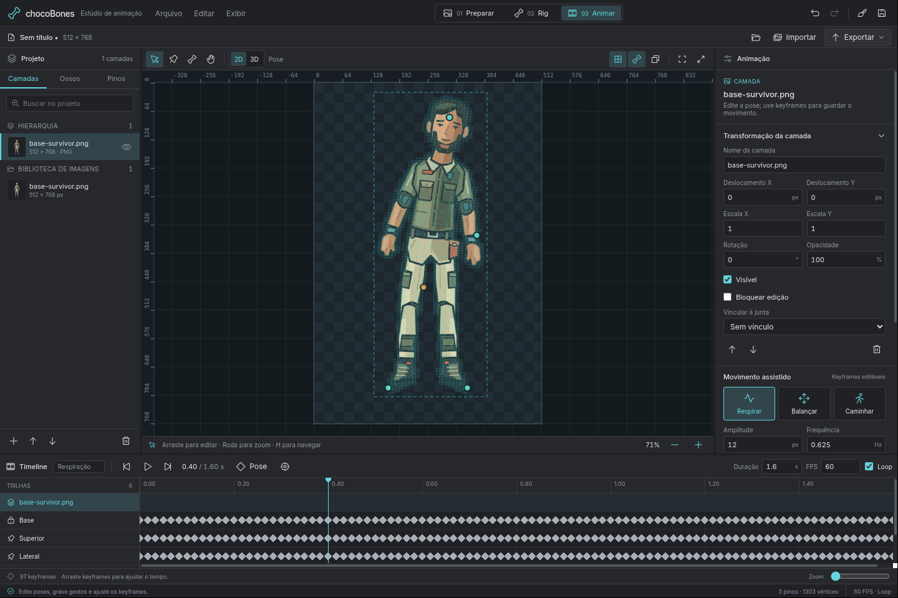
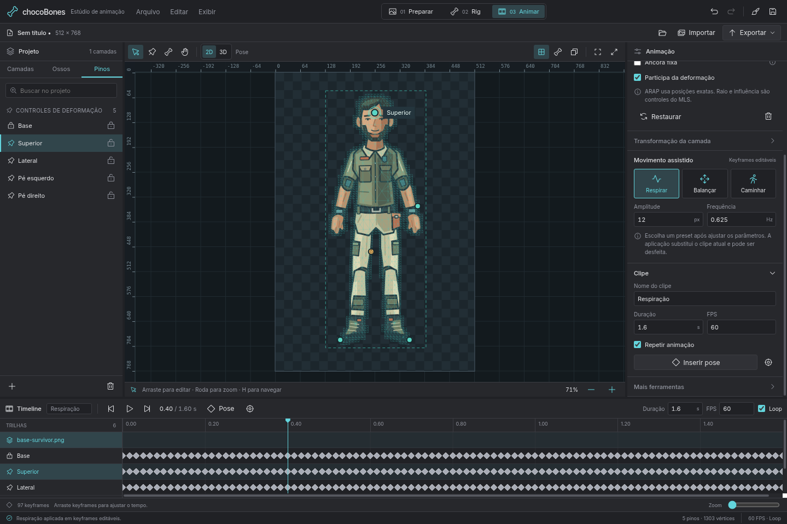

# Editor Solid e desktop Electrobun

Capturas do editor real com o PNG de teste do próprio projeto, `base-survivor.png` (512 × 768). Nenhuma interface foi desenhada para simular a aplicação. Os ícones são SVGs Phosphor distribuídos com o projeto.

Foram validados três ambientes, com relatórios separados:

| Ambiente | Execução | Resultado |
| --- | --- | --- |
| [Electrobun nativo](native/report.json) | Electrobun 2.0.2, Bun 1.4.0, CEF/Linux e Xvfb | 20 verificações; 7 capturas de fluxo e uma captura da janela X11 completa |
| [Pacote stable](packaged/report.json) | Electrobun/CEF Linux, view `views://`, sem Vite; arquivo extraído com tar do sistema | 25 verificações; 7 capturas; mais [4 verificações de fechamento nativo](packaged/close-guard.json) |
| [Preview no navegador](browser/report.json) | Chromium do sistema, Solid/Vite, WebGL2 com SwiftShader, DPR 2 | 19 verificações; 7 capturas em 1360 × 900 e 960 × 720 |

O Electrobun executou o fallback Canvas 2D porque a lista de bloqueio da GPU do CEF neste ambiente recusa WebGL2. O preview no Chromium executou WebGL2. Esse resultado demonstra os dois caminhos de apresentação; não constitui uma medição de aceleração GPU em hardware físico.



| Fluxo | Electrobun nativo | Chromium, DPR 2 |
| --- | --- | --- |
| Preparar, documento vazio | [Captura](native/01-prepare-empty.png) | [Captura](browser/01-prepare-empty.png) |
| Preparar, PNG importado | [Captura](native/02-prepare-imported.png) | [Captura](browser/02-prepare-imported.png) |
| Rig, MLS e pinos sugeridos | [Captura](native/03-rig-mls.png) | [Captura](browser/03-rig-mls.png) |
| Rig, ARAP e contorno refinado | [Captura](native/04-rig-arap-refined.png) | [Captura](browser/04-rig-arap-refined.png) |
| Animar, preset e timeline | [Captura](native/05-animate-breath.png) | [Captura](browser/05-animate-breath.png) |
| Animar, tema claro | [Captura](native/06-animate-light.png) | [Captura](browser/06-animate-light.png) |
| Animar, layout compacto | [Captura](native/07-animate-compact.png) | [Captura](browser/07-animate-compact.png) |
| PNG exportado com transparência | [Arquivo](native/artwork-current.png) | [Arquivo](browser/artwork-current.png) |

As verificações usam os controles DOM e eventos de ponteiro do palco para escolher MLS/ARAP, refinar e reconstruir a malha, desfazer/refazer, aplicar um preset, percorrer a timeline, arrastar um pino livre e tentar arrastar uma âncora fixa. Também verificam a supressão de atalhos durante a edição de campos, as dimensões do canvas em DPR 2 e a ausência de overflow horizontal.

No navegador, a importação e a abertura do projeto usam o seletor de arquivos real do navegador; os arquivos exportados são downloads reais. No desktop, a importação e a reabertura usam as chamadas RPC existentes com caminhos explícitos, enquanto a gravação e a exportação passam pelo diálogo HTML do editor e escrevem arquivos reais pelo host Bun. O seletor de arquivos do sistema operacional não foi automatizado.

A reabertura do projeto preservou o documento completo e produziu pixels de exportação idênticos. A importação nativa também verificou `bootstrap`, descritores de assets e o transporte binário PNG/RGBA pelo servidor de sessão. A captura X11 tem [metadados e hash](native/x11-capture.json).

Para repetir o fluxo do navegador, inicie `pnpm dev:web` e execute:

```sh
CHOCOBONES_QA_OUTPUT=/tmp/chocobones-solid-browser pnpm qa:editor
```

Para repetir na aplicação Electrobun em desenvolvimento, abra o host com depuração CEF local e execute:

```sh
CHOCOBONES_QA_CDP=http://127.0.0.1:9333 \
CHOCOBONES_QA_OUTPUT=/tmp/chocobones-solid-native pnpm qa:editor
```

O hook de QA é exposto em desenvolvimento ou com `CHOCOBONES_QA=1`, que acrescenta `?qa=1` à view empacotada. Ele fica ausente no lançamento padrão. A flag SwiftShader do teste é exclusiva do navegador de QA.

## Pacote desktop sem servidor de desenvolvimento



O pacote stable carregou fontes Inter, SVGs Phosphor e o worker pela origem `views://editor`. Importação, gravação/reabertura, exportação e persistência do tema passaram. O evento X11 `WM_DELETE_WINDOW` validou cancelar, cancelar salvamento e descartar no fechamento. [Captura da confirmação](packaged/08-native-close-confirmation.png).

O autoextrator Linux gerado pelo SDK falhou com `TarUnsupportedFileType`. O arquivo stable foi extraído com `tar --zstd` e o launcher interno executou os testes; isso valida a aplicação empacotada, mas não o instalador de distribuição. O tar gerado contém entradas GNU LongLink e links simbólicos; a causa interna do autoextrator ainda requer correção/validação no SDK.
